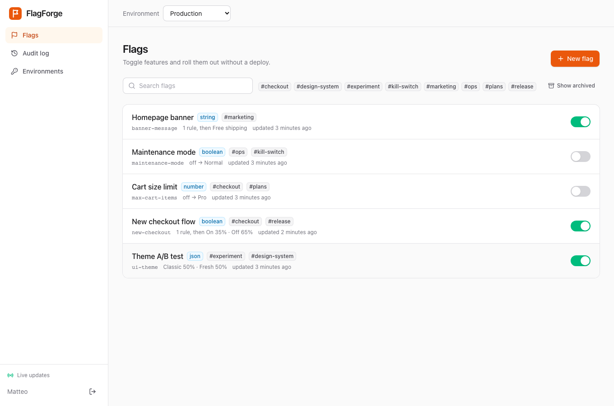
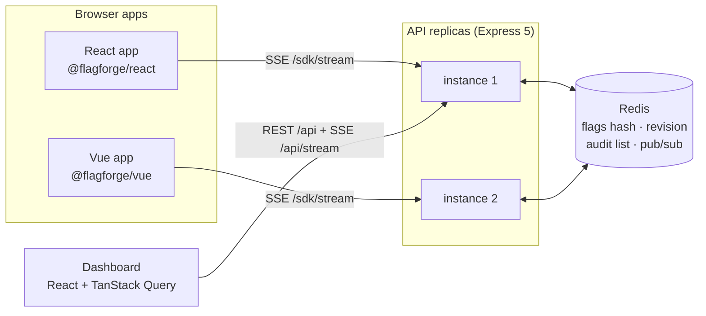
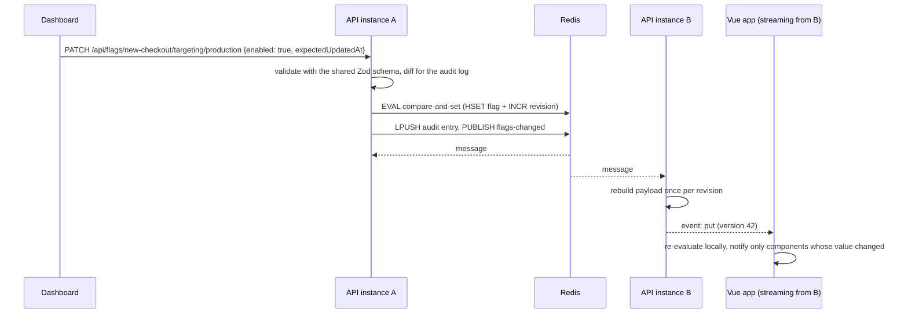
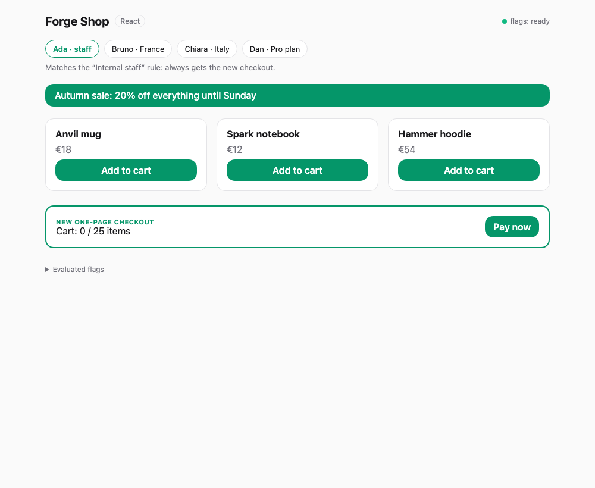

# 🚩 FlagForge

> Self-hosted feature flags with real-time streaming, percentage rollouts and native SDKs for React and Vue, built on one shared evaluation engine.




---

## 🎯 Purpose

In enterprise frontends, releasing is not the same as deploying. A feature ships dark, gets switched on for internal staff, then for 5% of users, then for Italy only, and is switched off in seconds if error rates move, all without a new build. That is what LaunchDarkly, Unleash or Adobe Target do, and it is what most portfolio projects never show.

**FlagForge** is a working, self-hosted implementation of that pattern:

- a **Node.js API** that stores flags in Redis, keeps an audit trail and streams every change over Server-Sent Events;
- one **deterministic evaluation engine** in TypeScript, shared by the server and every SDK, so a user gets the same variation everywhere;
- a framework-agnostic **JS SDK** (~2.7 kB gzipped) plus idiomatic **React** and **Vue** bindings, the same situation as enterprise codebases where both frameworks coexist;
- an **admin dashboard** with a draft-based targeting editor, rollout sliders, a "why does this user see that?" debugger and live updates.

---

## ✨ Features

| | |
| --- | --- |
| **Targeting rules** | `email endsWith @acme.com AND country in [IT, ES]` with 11 operators, array attributes and first-match-wins ordering |
| **Percentage rollouts** | Sticky bucketing with MurmurHash3. Raising 10% → 50% never takes the feature away from the first 10%. Bucket by any attribute (e.g. `company`) |
| **Multivariate flags** | Boolean, string, number and JSON variations. JSON flags can carry config such as design tokens |
| **Real-time updates** | SDKs and dashboards get changes in about 50 ms over SSE. Several writes in the same tick go out as one push |
| **Horizontal scaling** | Every replica subscribes to Redis pub/sub, so a write on any instance reaches SDKs on all of them |
| **Safe concurrent edits** | Optimistic locking (compare-and-set in a Lua script). A stale save gets a 409 instead of overwriting a teammate |
| **Audit log** | Who changed what, in plain language: `production: default rollout on 20% / off 80% → rollout on 35% / off 65%` |
| **Environments** | Separate targeting per environment, read-only SDK keys, key rotation that closes old streams immediately |
| **Resilient SDK** | Offline cache, SSR bootstrap, polling fallback, stale/error status. Serves code defaults when all else fails |
| **Evaluation reasons** | Every result explains itself (`RULE_MATCH`, `FALLTHROUGH` in rollout, `OFF`, `WRONG_TYPE`…), for debugging and experiment analytics |

---

## 🏗️ Architecture



**What happens when someone flips a flag:**



### Packages

```
flagforge/
├── packages/
│   ├── core/        # @flagforge/core   Zod schema, evaluation engine, MurmurHash3 bucketing
│   ├── server/      # @flagforge/server Express API, Redis/memory stores, SSE hub, audit log
│   ├── js/          # @flagforge/js     framework-agnostic client (streaming, polling, cache)
│   ├── react/       # @flagforge/react  <FlagForgeProvider>, useFlag, <Feature>…
│   └── vue/         # @flagforge/vue    plugin, useFlag (Ref), <FlagForgeFeature>, $flag
├── apps/
│   └── dashboard/   # admin UI (Vite, React 19, Tailwind v4, TanStack Query)
├── examples/
│   ├── react-demo/  # "Forge Shop" storefront in React
│   └── vue-demo/    # the same storefront in Vue
├── deploy/nginx.conf
├── docker-compose.yml   # Redis + 2 API replicas + nginx
└── Dockerfile           # multi-stage, runtime image without node_modules
```

Internal packages are consumed as TypeScript source ("just-in-time" packages): no build step between them, and Vite, Vitest and esbuild compile them where they are used.

---

## 🚀 Getting Started

### Option A: the full stack in Docker

```bash
docker compose up --build -d          # Redis, two API replicas, nginx on :4000
docker compose run --rm seed          # demo flags
```

Open **http://localhost:4000** and sign in with the token `dev-admin-token`.

### Option B: local development

```bash
npm install
docker compose up -d redis            # or leave REDIS_URL empty for the in-memory store
cp packages/server/.env.example packages/server/.env.local
npm run seed
npm run dev                           # API on :4000, dashboard on :5173
npm run dev:examples                  # React demo on :5174, Vue demo on :5175
```

Open both demos side by side, switch a flag in the dashboard and watch both storefronts change at once. Try the **maintenance-mode** kill switch, or change the **new-checkout** rollout percentage.



---

## 🧩 Using the SDKs

### React

```tsx
import { createClient } from '@flagforge/js'
import { FlagForgeProvider, Feature, useFlag, useIdentify } from '@flagforge/react'

const client = createClient({
  baseUrl: 'https://flags.example.com',
  sdkKey: 'sdk-production-…',
  context: { key: user.id, email: user.email, country: 'IT', plan: 'pro' },
})

root.render(
  <FlagForgeProvider client={client}>
    <App />
  </FlagForgeProvider>,
)

function Checkout() {
  const maxItems = useFlag('max-cart-items', 10) // re-renders only when this flag changes
  return (
    <Feature flag="new-checkout" fallback={<LegacyCheckout max={maxItems} />}>
      <OnePageCheckout max={maxItems} />
    </Feature>
  )
}

// After login: re-evaluated locally, no network round trip
const identify = useIdentify()
identify({ key: user.id, plan: 'pro' })
```

### Vue

```ts
import { createClient } from '@flagforge/js'
import { createFlagForge } from '@flagforge/vue'

createApp(App).use(createFlagForge(createClient({ baseUrl, sdkKey, context }))).mount('#app')
```

```vue
<script setup lang="ts">
import { FlagForgeFeature, useFlag } from '@flagforge/vue'
const banner = useFlag('banner-message', '') // ComputedRef<string>
</script>

<template>
  <div v-if="banner" class="banner">{{ banner }}</div>
  <FlagForgeFeature flag="new-checkout">
    <OnePageCheckout />
    <template #fallback><LegacyCheckout /></template>
  </FlagForgeFeature>
</template>
```

### Anywhere else

```ts
const client = createClient({ baseUrl, sdkKey, context: { key: 'user-1' } })
await client.ready() // resolves on the first payload, cache or bootstrap; never rejects
client.variation('new-checkout', false)
client.variationDetail('new-checkout', false) // { value, variationId, reason }
client.subscribe(({ keys }) => console.log('changed:', keys))
```

| Option | Default | |
| --- | --- | --- |
| `streaming` | `true` if `EventSource` exists | Real-time updates over SSE |
| `pollIntervalMs` | `30000` | Used when streaming is off; `0` fetches once |
| `bootstrap` | none | Payload rendered on the server, for SSR hydration without flicker |
| `storage` | `localStorage` | Offline cache of the last payload; `null` disables it |

---

## 🧠 Evaluation Model

For each flag in an environment:

1. **Off** → serve the *off variation*.
2. **On** → go through the rules **top to bottom**; the first rule whose conditions **all** match decides.
3. No rule matches → the **default rule** (fixed variation or percentage rollout).

Rollouts hash `flagKey.salt.bucketValue` with MurmurHash3 into `[0, 100)`. Each flag has its own random salt, so being in the 10% of one flag says nothing about another. The hash is the same in Node and every browser, which a test suite pins against reference vectors.

Two deliberate semantics:

- **A missing attribute never matches**, even for `notIn`. `country notIn [IT]` must not catch users whose country is unknown.
- **The code default is a type contract.** `useFlag('banner', '')` against a boolean flag returns `''` with reason `WRONG_TYPE`, not a surprise `true`.

---

## ⚖️ Design Decisions and Trade-offs

**Local evaluation in the SDK.** The browser downloads the environment's rules and evaluates them itself, so `useFlag` is a synchronous in-memory read and `identify()` after login costs no request. The trade-off is that targeting rules (e.g. an internal email domain) are visible to the client. For flags where that matters, `POST /sdk/evaluate` evaluates on the server and returns values only. Both paths run the same engine.

**SSE rather than WebSockets.** Flag updates go one way. SSE is plain HTTP, gets automatic reconnection from the browser, passes through proxies and CDNs, and needs no extra library on either side. The nginx config and the heartbeat comments are the whole operational cost.

**Redis as both store and bus.** A single hash holds every flag (one `HGETALL` builds a payload), a counter gives a global monotonic revision, and pub/sub fans changes out to replicas. Payloads are rebuilt once per revision, however many SDKs reconnect. The `Store` interface keeps Redis swappable, and a shared contract test runs against both the Redis and in-memory implementations.

**Optimistic locking instead of locks.** `updatedAt` doubles as a version token, and a Lua script does the compare-and-set atomically. The dashboard sends the version it was editing, so conflicting saves are rejected with a clear message. API calls without a version replay their change on the fresh copy.

**Zod stays on the server.** The core exposes a separate `engine` entry point with no schema code. Browser bundles contain the evaluator only (verified: zero Zod references in the demo builds). Payloads get a structural check on the client, and full validation happens on every write.

**Archive before delete.** A flag must be archived (SDKs then fall back to code defaults) before it can be deleted, which turns an irreversible action into a two-step one.

---

## 📡 API Reference

Admin endpoints need `Authorization: Bearer <ADMIN_TOKEN>`. `X-FlagForge-Actor` names the author in the audit log.

| Method | Endpoint | Description |
| --- | --- | --- |
| GET | `/api/flags` | List flags |
| POST | `/api/flags` | Create a flag (boolean by default) |
| GET / PATCH / DELETE | `/api/flags/:key` | Read, update metadata/variations/archive, delete (archived only) |
| PATCH | `/api/flags/:key/targeting/:env` | Update `enabled`, `rules`, `fallthrough`, `offVariationId` (+ `expectedUpdatedAt`) |
| POST | `/api/flags/:key/evaluate` | Evaluate the saved config for a context |
| GET | `/api/environments` | Environments with SDK keys and live connection counts |
| POST | `/api/environments/:env/rotate-sdk-key` | Rotate a key and close streams using the old one |
| GET | `/api/audit?flagKey=&limit=` | Audit log, newest first |
| GET | `/api/stream?token=` | Admin SSE stream (used by the dashboard) |

SDK endpoints take the environment's SDK key (`Authorization: <key>` or `?sdkKey=`) and allow CORS.

| Method | Endpoint | Description |
| --- | --- | --- |
| GET | `/sdk/flags` | Environment payload `{ environment, version, flags }` |
| GET | `/sdk/stream` | SSE: `put` on connect and after every change, `revoked` on key rotation |
| POST | `/sdk/evaluate` | Server-side evaluation of every flag for `{ context }` |
| GET | `/health` | Liveness plus store connectivity |

### Configuration

| Variable | Default | |
| --- | --- | --- |
| `PORT` | `4000` | |
| `REDIS_URL` | none | Empty means the in-memory store (single instance, not persistent) |
| `ADMIN_TOKEN` | required | At least 8 characters |
| `ENVIRONMENTS` | `development,staging,production` | Created on boot, added to existing flags as "off" |
| `SDK_KEYS` | none | `env=key,…` fixed keys applied on first creation (demos only) |
| `SDK_CORS_ORIGINS` | `*` | Allowed origins for browser SDKs |
| `DASHBOARD_DIR` | none | Serve the built dashboard from the API |

---

## 🧪 Testing

```bash
npm test                                         # 150+ tests across all packages
TEST_REDIS_URL=redis://localhost:6379 npm test   # also the Redis store and multi-instance streaming
npm run lint && npm run typecheck
```

- **core**: evaluation semantics, MurmurHash3 reference vectors, bucketing distribution and rollout stickiness, schema cross-validation
- **server**: service logic (locking, audit diffs, no-op detection, replay on concurrent writes), HTTP API with real SSE streams, one store contract suite run against both memory and Redis, and a **two-instance test** proving a write on one replica reaches a stream on the other
- **js / react / vue**: streaming, polling, cache, version ordering, `identify`, per-flag re-render isolation, components and composables
- **dashboard**: rollout weight rebalancing, formatting, component behaviour

CI (GitHub Actions) runs lint, typecheck, the full suite against a Redis service, the build and the Docker image build.

---

## 🗺️ Roadmap

- **Flag insights:** SDKs report evaluation counts per variation, and the dashboard flags code that no longer reads a flag (stale-flag cleanup)
- **Scheduled changes:** "turn on in production Monday at 09:00" and progressive rollouts that step up automatically
- **Segments:** reusable audiences ("beta testers", "EU customers") referenced by many rules
- **Real identity:** OIDC login and per-environment roles instead of a shared admin token
- **Approval workflow** for production changes, built on the existing draft model
- **Server-side SDK** for Node with a local rule cache, and an OpenFeature provider

---

## 📄 License

MIT
